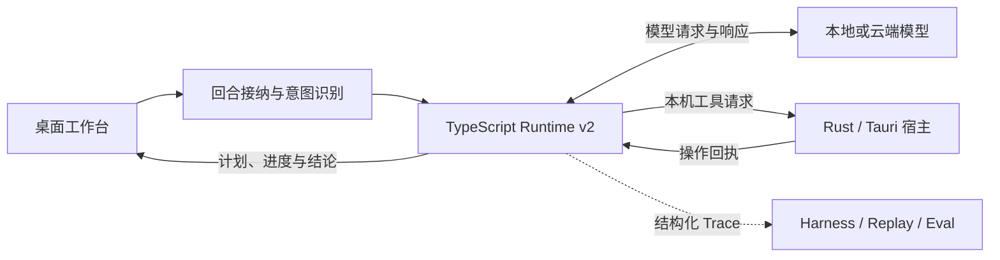

<div align="center">
  
  <h1>MAIN</h1>
  <p><strong>开源、本地优先的桌面编码工作台</strong></p>
  <p>连接本地或云端模型，在同一个对话里理解代码、审阅方案、修改项目并验证结果。</p>

  <p>
    <a href="https://github.com/MSTUDIOHUB/MAIN-Releases/releases/latest"></a>
    <a href="https://github.com/MSTUDIOHUB/MAIN/actions/workflows/ci.yml"></a>
    <a href="LICENSE"></a>
  </p>
</div>

## 快速开始

1. 下载与你的系统匹配的 ZIP，解压后启动 MAIN。公开版本提供 macOS Apple Silicon、macOS 通用版和 Windows x64。[下载最新版本](https://github.com/MSTUDIOHUB/MAIN-Releases/releases/latest) · [安装与更新](docs/main-manual/install-and-update.md)
2. 点击顶部模型状态进入设置。使用本地模型时，启动 LM Studio、Ollama 或 OMLX，填写服务地址并扫描模型。使用云端模型时，选择 OpenAI Compatible（Chat Completions）、OpenAI Responses API、Anthropic 或 Gemini，填写服务地址、模型和所需凭证。[本地模型配置](docs/main-manual/local-models.md) · [云端模型配置](docs/main-manual/cloud-models.md)
3. 在左侧添加项目文件夹并打开会话。第一次可以发送「请只读分析这个项目，指出主要入口和测试命令」，然后查看读取记录和结论。[快速开始手册](docs/main-manual/quickstart.md)

工作区会话和运行记录保存在本机。使用云端模型时，当前任务所需的上下文会发送给你配置的服务。

## 在同一个对话里工作

MAIN 根据你要求的结果选择问答、只读分析、计划或执行。可以用自然语言提出任务，也可以用命令明确指定计划或访谈。

| 你想做什么 | 怎么开始 | MAIN 会做什么 |
| --- | --- | --- |
| 问答 | 「解释一下这个报错通常是什么原因」 | 直接答复，适合解释概念或通用报错。 |
| 检查代码 | 输入 `@` 选择文件，再说「只读检查这段代码，定位失败原因」 | 读取相关源码，给出依据和结论。 |
| 实施改动 | 「修复刚才定位的问题，并运行相关测试」 | 根据当前文件和前序检查结果推进修改与验证。 |
| 先审阅方案 | `/计划`（`/plan`）加上目标和验收要求 | 调研并生成可审阅的计划。实施计划经批准后按该版本的范围继续执行。 |
| 先讨论关键取舍 | `/grill-me` 加上你的需求 | 调研后通过结构化问题确认关键决定，再形成方案。 |
| 整理项目规则 | `/规则`（`/rules`） | 调研项目并起草根目录的 `AGENTS.md`，审阅差异并确认保存后写入。旧命令 `/init` 仍可使用。 |

### 计划、审批与验证

实施计划以版本化的工作计划（WorkPlan）记录改动范围、步骤和验收条件。计划阶段进行只读调研，生成的文档可以在工作台审阅。仅需方案时，交付物是计划文档。批准实施计划后，MAIN 在该版本授权的范围内继续处理。计划修订形成新版本时，需要重新审阅和批准。[计划与结构化访谈](docs/main-manual/plan-mode.md)

执行过程中可查看工具记录、文件 Diff、终端输出和计划进度。文件修改、Shell 命令和外部操作继续受各自的权限策略约束，需要确认时会显示审批卡片。接入受信任执行层的操作还会在 Rust 侧检查路径、命令或网络目标。校验在应用层进行，获准启动的程序仍以当前系统用户的权限运行。[权限与审批](docs/main-manual/permissions-and-approval.md) · [受信任执行边界](docs/TRUSTED_EXECUTION.md)

MAIN 根据实际修改和验证结果汇总交付情况，包括测试、编译或交互检查的结果。缺少必要验证时，结论会标出缺项，或在需要审批、补充条件时保留进度以便续跑。[代码工作流](docs/main-manual/coding-workflows.md)

### 会话、队列与协作

- **会话与恢复**　工作区内每次提交记录为一个回合（Turn），推进该回合的每次尝试记录为一次运行（Run）。切换会话或重启后，可以恢复历史、待审计划和符合恢复条件的任务。[工作区与会话](docs/main-manual/workspaces-and-sessions.md)
- **排队与引导**　任务运行时，「排队」保存一个按顺序处理的新回合。「引导」把一条文本补充发给当前运行，供下一次模型请求使用。
- **子智能体**　开启协作后，MAIN 可以在模型并发容量允许时委派独立的调查与审查。已批准计划中的独立文件改动可在授权范围内暂存，由主智能体核验后写入并统一验收。

## 工作区能力

| 能力 | 使用方式 |
| --- | --- |
| 文件、Git 与终端 | 搜索和编辑项目文件，查看 Git 状态与 Diff。用 Shell 运行测试或构建，用交互式终端（PTY）运行开发服务器等长驻进程。[Git 工作流](docs/main-manual/git-workflows.md) · [终端与工具](docs/main-manual/terminal-and-tools.md) |
| 浏览器验证 | 检查可访问页面的 DOM、控制台和交互结果，配合项目命令验证 Web 改动。[工具参考](docs/main-manual/tools-reference.md) |
| 知识库 | 导入资料并建立本地索引，输入 `#` 为当前消息选择资料库或文档，查看实际引用的来源和片段。[知识库](docs/main-manual/knowledge-base.md) |
| Skills 与 MCP | 从本地目录、ZIP 或 GitHub 添加技能，输入 `$` 选择可用的 Skill。配置 MCP 服务器接入外部工具。[技能与协议包](docs/main-manual/skills-and-protocols.md) · [MCP 服务器](docs/main-manual/mcp.md) |
| 游戏引擎项目 | 任务需要时识别 Unity、Godot、Unreal Engine 和 UEFN 工程，结合项目元数据、已配置的手册与现有验证命令工作。环境就绪的 Unity 工程还可验证 C# 编译与 Shader 导入。[Unity 工具链](docs/UNITY_CLI_SKILL_WORKFLOW.md) |
| 飞书远程控制 | 配置适配器并配对后，可以通过飞书私聊向已关联的工作区会话提交任务。[飞书远程控制](docs/main-manual/feishu-remote-control.md) |

2.4.2 增强了多引擎识别、中文和英文输出的一致性以及计划恢复。OMLX 的「合并意图识别与首轮回复」是默认关闭的实验选项，开启后可在一次请求中处理意图识别与普通问答的首轮回复，遇到无效响应时回退到标准流程。[2.4.2 发布说明](docs/releases/Release_Notes_2.4.2_ZH.md)

## 重构后的架构

MAIN 使用 React 和 Tauri 2 构建桌面工作台。TypeScript Runtime v2 负责生产任务的意图路由、模型循环、审批、恢复和结论。Rust 宿主负责本机操作校验、进程管理和会话存储。模型适配层处理不同服务的请求、流式响应与工具协议，任务状态由运行时根据计划和工具回执推进。



| 开发方向 | 源码入口 |
| --- | --- |
| 任务路由、计划与恢复 | [提交入口](src/store/submitAsyncWorkflowRun.ts) · [运行时分发](src/store/submitRuntimeRunner.ts) · [生产 Runner](src/store/runtimeV2/) · [Runtime v2 核心](src/lib/runtime-v2/) |
| 模型协议与工具扩展 | [本地 Provider 路由](src/lib/localProviderRouting.ts) · [云端协议](src/lib/cloudProtocol.ts) · [工具定义](src/lib/toolSchemas.ts) · [工具执行](src/lib/toolExecutor.ts) |
| 桌面交互、权限与持久化 | [React 组件](src/components/) · [受信任执行](src-tauri/src/trusted_execution.rs) · [网络校验](src-tauri/src/network_guard.rs) · [会话存储](src-tauri/src/session_store.rs) |
| 确定性回放与回归 | [Rust Harness](src-tauri/src/harness/) · [评测夹具](benchmark/) · [Node 与 Playwright 测试](tests/) |
| 工作区扩展资产 | [项目规则、模板、Hooks 与权限示例](.MAIN/) |

[架构与职责](docs/ARCHITECTURE.md) · [Run / Turn 生命周期](docs/RUNTIME_LIFECYCLE.md) · [Session 持久化](docs/SESSION_PERSISTENCE.md) · [测试与回放](docs/TESTING_AND_REPLAY.md)

## 从源码运行

开发和回归测试可使用 Node.js 24。运行桌面版还需要 Rust stable 和对应系统的 [Tauri 2 前置依赖](https://v2.tauri.app/start/prerequisites/)。

```bash
git clone https://github.com/MSTUDIOHUB/MAIN.git
cd MAIN
npm ci
npm run tauri dev
```

以下命令对应 CI 的前端检查和 Node 回归测试。

```bash
npm run lint
npm run build
npm run test:workflow-assets
```

Rust 测试使用 `cargo test --manifest-path src-tauri/Cargo.toml`。前端端到端测试使用 `npm run test:e2e`，可通过 `npx playwright install chromium` 安装浏览器依赖。[桌面打包与发布](docs/Release_Guide_ZH.md)

## 参与贡献

欢迎贡献文档、Bug 修复、模型适配、工具和回归用例。提交者应审阅改动、核实验证结果，并对交付内容负责。[贡献指南](CONTRIBUTING.md) · [行为准则](CODE_OF_CONDUCT.md) · [安全问题报告](SECURITY.md)

MAIN 是独立开源项目，采用 [Apache License 2.0](LICENSE)。
