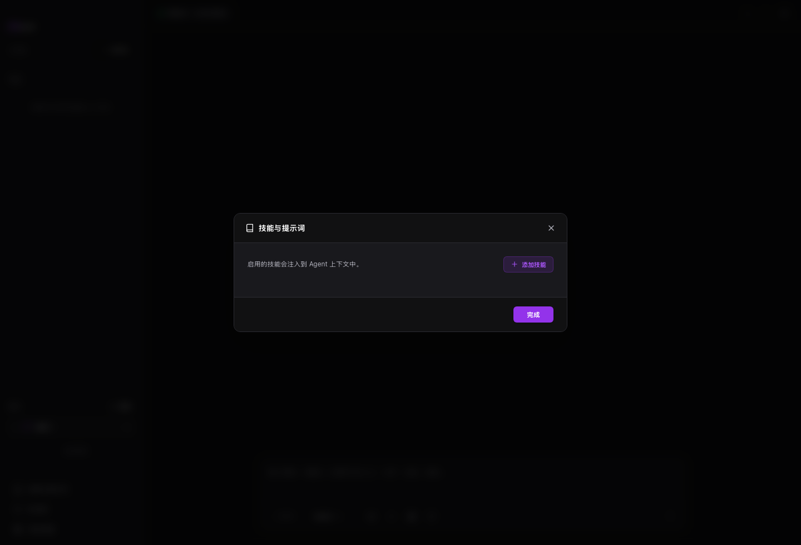

# 技能与协议包

MAIN 的 Agent Skill 是一组可复用工作流说明。启用后，Runtime 在 Turn 入场时冻结 Skill 目录；未选中的技能只提供名称和用途。选中后，短 `SKILL.md` 完整加载，长文先提供原文前言和章节索引，再通过只读 `load_skill` 按需读取原始章节。Skill 不会绕过文件、Shell、网络或 MCP 的既有权限。



## 适用场景

- 团队有固定规范。
- 某类任务经常重复。
- 需要把可复用说明和支持文件作为协议包导入工作区。

## 前置条件

- 已准备 Skill 名称、用途描述和 Markdown 说明，或包含一个或多个 `SKILL.md` 的 ZIP。
- 导入 ZIP 前，先在 MAIN 打开目标项目；包和全部资源会安装到该项目。
- 如果 Skill 需要外部能力，对应能力必须已经注册为内置工具、MCP 或插件工具。

## 步骤

1. 打开技能与提示词。
2. 新建或导入技能。
3. 填写名称、准确的用途描述和 `SKILL.md` 内容。
4. 决定是否开启“允许模型自动匹配”。关闭后只能手动启用。
5. 保存并启用；不需要重启，下一次 Turn 会读取新的目录版本。
6. 可在消息中写 `$技能名` 或 `@技能名`，确定性地启用一个 Skill。

### 导入 Unity 官方 Skills（推荐）

1. 在 MAIN 打开你的 **Unity 项目根目录**，即同时包含 `Assets/`、`Packages/` 和 `ProjectSettings/` 的文件夹。
2. 打开 [Unity 官方 Skills 仓库](https://github.com/Unity-Technologies/skills)，选择 **Code → Download ZIP**。保留完整 ZIP，无须手动解压或修改官方技能。
3. 在 MAIN 打开 **技能与提示词 → 添加技能 → 协议包 → 上传 ZIP**，选择刚下载的文件。
4. 等待界面显示发现的技能数量，检查预览中的名称和描述。填写集合名称，例如 `Unity 官方 Skills`，保留“允许模型自动匹配”，然后点击 **保存技能**。
5. 下一条消息即可使用。需要确定使用某个技能时，写其预览中的实际名称，例如 `$unity-cli`、`$ui` 或 `$build-gtk`；集合名称用于管理整包，不是包内技能的调用名称。

一个 ZIP 中的全部 `SKILL.md` 都会分别成为可发现的技能，`references/`、`scripts/`、`resources/` 等文件保留原目录结构。列表中的整包开关控制该集合的所有技能；删除整包会清理该项目中的安装目录。更新时先导入新版并核对预览，再删除旧包，避免重复名称影响显式调用。此前用旧版 MAIN 导入过整仓 ZIP 的用户，请重新导入一次，以登记全部技能入口。

第一次操作 Unity 时，可以发送：

```text
请使用 $unity-cli 检查当前 Unity 项目和本机运行环境。缺少 Unity CLI 时按官方说明安装；需要连接编辑器时检查 Unity 版本，并为当前项目安装所需的 Pipeline 包。最后报告 CLI 版本、目标项目路径和 Editor 连接状态。
```

按 MAIN 显示的权限提示批准所需命令；若需要 Unity 登录或许可证，在 Unity Hub 完成相应步骤。控制运行中的 Editor 需要 Unity 6.0+、项目中的 `com.unity.pipeline` 包及可连接的 Editor；具体技能还可能要求特定包或更高 Editor 版本。技能文件本身不会安装这些依赖。准备完成后，例如发送：

```text
请使用 $ui，为当前 Unity 项目制作一个开始菜单，并在编辑器中检查结果。
```

后续可以直接描述任务，让模型按用途匹配技能。初始目录会根据上下文预算缩短描述；完整元数据仍可通过 `load_skill` 的 `operation: "list"` 分页读取，正文按选择加载，用户无需手动调用该工具。

长技能会明确区分“已选中”和“已完整读取”。分节读取保留原文、版本、精确范围及继续读取位置，不生成替代说明；全部内容仍可读取。章节索引也可分页，避免大型参考手册占满每次请求。这个长文读取方式是 MAIN 对本地模型的适配；Codex 官方文档描述的是选中后读取完整 `SKILL.md`。

### 从文件夹添加其他标准 Skills

将每个技能的完整目录复制到项目 `.agents/skills/<skill-name>/`，保证目录内包含 `SKILL.md`；下一条消息会自动扫描，无需重启。个人共用技能可放到 `$HOME/.agents/skills/<skill-name>/`。项目内符号链接的真实目标必须仍位于项目内；个人技能目录支持链接到其他位置。

复制时保留所有支持文件。MAIN 返回的支持文件清单是有限索引，其他相对引用仍以该技能的基目录解析、按需读取。个人目录中的工作区外文件继续遵循本地文件读取授权。

可选的 `agents/openai.yaml` 支持 `allow_implicit_invocation: false`，用于只允许手动启用的 Skill。支持文件仍需通过普通受权工具按需读取或执行。

### 导入 Gemini CLI 扩展

在项目中打开“技能与提示词”，找到“Gemini CLI 扩展”，点击“导入 Gemini ZIP”。选择包含 `gemini-extension.json` 的 ZIP，查看预览并勾选需要的组件，然后点击“安装所选组件”。可以导入仅 Skills、仅 HTTP MCP 或两者兼有的扩展。

首版支持扩展 `skills/` 下的 `SKILL.md` 和配套资源，以及使用 `httpUrl` 配置、无需认证的 Streamable HTTP MCP。Skill 仍按需加载。HTTP MCP 安装后需要点击“测试并发现工具”；连接成功后，新任务才能使用发现的工具。导入预览不会连接服务或运行包内脚本。

扩展仅在安装时选择的项目生效。扩展列表可启用、停用、更新或卸载；更新需要选择新版 ZIP。项目有进行中或暂停任务时，先结束这些任务再调整已有扩展，避免任务引用的资源被替换。重启 MAIN 后需要重新发现 HTTP MCP 工具。

预览会列出未支持内容：需要请求头、认证、配置变量、工具过滤或自定义超时的 MCP，以及 SSE、stdio、Commands、Hooks、子 Agent、主题和 `GEMINI.md` 等。未支持的 MCP 不能勾选启用，其他未支持内容不会自动生效。Gemini 的 `url` 表示 SSE，只有 `httpUrl` 对应本版支持的传输。扩展说明不会被写入项目 `AGENTS.md`；无需先运行 `/init`。

扩展以项目内的文件快照保存，保留支持文件的相对路径；更新或卸载不会删除手动添加的 MCP 服务或其他扩展。同名 Skill 可能导致显式调用歧义，应在导入前检查现有技能。

## 结果确认

- Skill 出现在面板，或位于项目 `.agents/skills/` 目录。
- 启用后，下一次 Execute、Plan 或 Goal Turn 的模型请求包含 Skill 名称和描述，但不包含未选择的正文。
- 模型选择后会出现 `load_skill` 工具记录；其结果包含实际读取的正文、来源、基目录、revision，以及完整或部分读取状态。
- 显式 `$技能名` / `@技能名` 在首个请求前选择同一份冻结内容；长文只先加载前言和索引，相关章节由模型继续读取。
- Skill 后续动作仍显示为普通工具记录，并继续受原权限策略约束。

## 常见问题

**技能和普通提示词有什么区别？**
工作区规则会始终进入该 Turn；Skill 采用渐进披露，只在显式启用或模型根据描述匹配后读取正文。长文可按原始章节和范围继续读取。

**技能越多越好吗？**
不是。目录有上下文预算；描述应短而准确，只启用当前任务可能需要的 Skill。

**协议包是什么？**
协议包是包含一个或多个 `SKILL.md` 及可选支持文件的 ZIP。MAIN 将其安装到当前工作区 `.protocols/<package>/`，校验每个入口和路径后，分别按普通 Skill 使用。兼容旧包时也支持单个 `program.md` 入口。ZIP 本身不会被当作任意代码直接执行。

**官方技能中的工具名与 MAIN 不同怎么办？**

技能可以使用 Bash、Read、Edit、WebFetch 等其他宿主的称谓。MAIN 会提示模型用当前实际提供的等价能力执行；这些称谓和 `allowed-tools` 元数据不会注册额外工具或授予权限。Shell、网络、MCP 或交互能力未就绪时，应先处理具体依赖和授权。

**“允许模型自动匹配”是否保证调用？**
不保证。它表示名称和描述会成为模型候选；是否匹配由模型决定。需要保证使用时，请显式写 `$技能名` 或 `@技能名`。

**旧版“工具描述”为什么没有直接执行？**
没有稳定执行器绑定的 function schema 会形成不可调用的幽灵工具，因此 MAIN 只把其正文当作工作流 Skill。真实工具必须绑定到内置、MCP 或插件执行器，并通过同一权限链。

## 下一步

- 阅读 [MCP 服务器](mcp.md)，为工具能力提供外部执行端。
- 阅读 [设置参考](settings-reference.md)，找到 Skills 入口。
