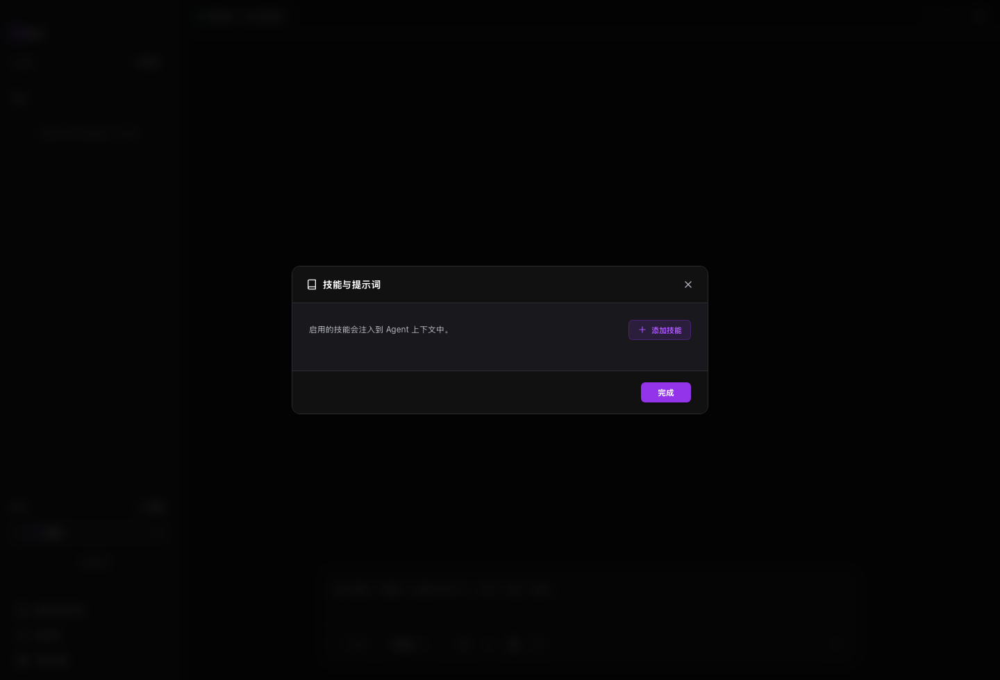

# 技能与协议包

MAIN 的 Agent Skill 是一组可复用工作流说明。启用后，Runtime 在 Turn 入场时冻结 Skill 目录；未选中的技能只提供名称和用途。选中后，短 `SKILL.md` 完整加载，长文先提供原文前言和章节索引，再通过只读 `load_skill` 按需读取原始章节。Skill 不会绕过文件、Shell、网络或 MCP 的既有权限。



## 适用场景

- 团队有固定规范。
- 某类任务经常重复。
- 需要把可复用说明和支持文件安装一次，在不同项目使用。

## 前置条件

- 已准备 Skill 名称、用途描述和 Markdown 说明，或包含一个或多个 `SKILL.md` 的 ZIP。
- ZIP 技能包默认全局安装，未打开项目时也可导入。实际修改、运行命令或操作 Editor 前，仍需选择正确的项目。
- 如果 Skill 需要外部能力，对应能力必须已经注册为内置工具、MCP 或插件工具。

## 步骤

1. 打开技能与提示词。
2. 新建或导入技能。
3. 填写名称、准确的用途描述和 `SKILL.md` 内容。
4. 决定是否开启“允许模型自动匹配”。关闭后只能手动启用。
5. 保存并启用；不需要重启，下一次 Turn 会读取新的目录版本。
6. 可在消息中写 `$技能名` 或 `@技能名`，确定性地启用一个 Skill。

### 导入 Unity 官方 Skills（推荐）

1. Unity 通用 Skills 只需安装一次，不必为每个 Unity 项目重复导入。
2. 打开 [Unity 官方 Skills 仓库](https://github.com/Unity-Technologies/skills)，选择 **Code → Download ZIP**。保留完整 ZIP，无须手动解压或修改官方技能。
3. 在 MAIN 打开 **技能与提示词 → 添加技能 → 协议包 → 上传 ZIP**，选择刚下载的文件。
4. 等待界面显示发现的技能数量，检查预览中的名称和描述。填写集合名称，例如 `Unity 官方 Skills`，保留“允许模型自动匹配”，然后点击 **保存技能**。
5. 实际开发前，在 MAIN 打开你的 **Unity 项目根目录**，即同时包含 `Assets/`、`Packages/` 和 `ProjectSettings/` 的文件夹，并确认 Editor 打开同一目录。需要确定使用某个技能时，写其预览中的实际名称，例如 `$unity-cli`、`$ui` 或 `$build-gtk`；集合名称用于管理整包，不是包内技能的调用名称。

一个 ZIP 中的全部 `SKILL.md` 都会分别成为可发现的技能，`references/`、`scripts/`、`resources/` 等文件保留原目录结构。全局技能包可在不同项目使用；重复导入完全相同的内容会复用已有安装，并保留启用和自动匹配设置。不同内容的包可以并存，不会只因名称相同而合并。

MAIN 应使用独立 Skills 仓库的 ZIP。Unity 面向 Codex、Claude 等宿主的官方插件包与独立仓库可能更新不同步；导入后应核对实际技能列表。操作运行中的 Editor 时，检查 `unity-cli` 和 `unity-pipeline` 是否都可发现。更新已有集合时，在原卡片选择“编辑技能”并上传新版 ZIP，避免把不同版本作为两份集合同时启用。

整包开关控制该集合的所有技能；删除后，新任务不再发现该集合。旧版安装到项目内的包会在成功验证、复制后迁为全局记录；无法迁移的记录保留原项目范围。项目内的旧资源不会因迁移被自动删除。

第一次操作 Unity 时，可以发送：

```text
请使用 $unity-cli 检查当前 Unity 项目和本机运行环境。缺少 Unity CLI 时按官方说明安装；需要连接编辑器时检查 Unity 版本，并为当前项目安装所需的 Pipeline 包。最后报告 CLI 版本、目标项目路径和 Editor 连接状态。
```

按 MAIN 显示的权限提示批准所需命令；若需要 Unity 登录或许可证，在 Unity Hub 完成相应步骤。控制运行中的 Editor 需要 Unity 6.0+、项目中的 `com.unity.pipeline` 包及可连接的 Editor；具体技能还可能要求特定包或更高 Editor 版本。技能文件本身不会安装这些依赖。准备完成后，例如发送：

```text
请使用 $ui，为当前 Unity 项目制作一个开始菜单，并在编辑器中检查结果。
```

Skill 的命令示例可能针对其他 Pipeline 版本。以当前安装包文档及实际命令接口核对名称和参数；不必预先读取完整命令 schema。批量创建对象或关联组件时，官方 `unity-pipeline` Skill 提供项目构建脚本的工作流：通过正常文件工具保存代码，再由 Pipeline 执行。代码修改、编译成功、进入 Play、实际帧推进及游戏交互是不同验收步骤。

后续可以直接描述任务，让模型按用途匹配技能。初始目录会根据上下文预算缩短描述；完整元数据仍可通过 `load_skill` 的 `operation: "list"` 分页读取，正文按选择加载，用户无需手动调用该工具。

长技能会明确区分“已选中”和“已完整读取”。分节读取保留原文、版本、精确范围及继续读取位置，不生成替代说明；全部内容仍可读取。章节索引也可分页，避免大型参考手册占满每次请求。这个长文读取方式是 MAIN 对本地模型的适配；Codex 官方文档描述的是选中后读取完整 `SKILL.md`。

全局包的参考文件也通过只读 `load_skill` 按需加载。读取说明或脚本文本不会执行脚本；后续命令、项目写入、网络与 Editor 操作仍按当前项目和每次工具调用的权限检查。

### 从文件夹添加其他标准 Skills

将每个技能的完整目录复制到项目 `.agents/skills/<skill-name>/`，保证目录内包含 `SKILL.md`；下一条消息会自动扫描，无需重启。个人共用技能可放到 `$HOME/.agents/skills/<skill-name>/`。项目内符号链接的真实目标必须仍位于项目内；个人技能目录支持链接到其他位置。

复制时保留所有支持文件。MAIN 返回的支持文件清单是有限索引，其他相对引用仍以该技能的基目录解析、按需读取。个人目录中的工作区外文件继续遵循本地文件读取授权。

可选的 `agents/openai.yaml` 支持 `allow_implicit_invocation: false`，用于只允许手动启用的 Skill。支持文件仍需通过普通受权工具按需读取或执行。

### 从 Git 来源安装和手动更新

MAIN 面板支持 GitHub 和 ZIP 技能包快照。也可以使用 Unity 仓库推荐的 Skills CLI，从 Git 来源安装到 MAIN 已支持的个人目录：

在 MAIN 中通过 GitHub 安装后，技能包卡片会记录仓库和分支，并提供“检查更新”。检查会下载并校验该分支的当前快照；有变化时，先查看新旧版本和技能数量，再点击“更新”。已是最新版本时不会更改注册，网络或校验失败也会保留当前版本。MAIN 不在后台自动检查或替换技能包。

更新保留技能包的名称、描述、启用状态和自动匹配设置，只对下次执行生效；进行中的任务继续使用原快照。检查期间修改或删除包会使候选失效，需要重新检查。目标版本已由另一个包注册时，不会静默合并或更改双方设置。

旧版导入未记录仓库地址时，需要在“编辑技能”中填写 GitHub 仓库和分支、重新下载并保存，才能使用检查更新。相同内容的 GitHub 重导入也可以为无来源记录关联仓库，保留原有设置；重复导入不会覆盖已有来源。需要更换来源时，在编辑中重新下载并保存。ZIP 和本机发现的技能继续由其原来源管理。

如果使用外部 Skills CLI 管理本机目录，可运行：

```sh
npx skills add Unity-Technologies/skills --global --agent codex --skill '*'
npx skills check
npx skills update --global
```

这里的 `--agent codex` 选择 `~/.agents/skills` 安装目录，执行任务的宿主仍由用户选择。该个人目录也可能被其他兼容宿主发现。安装位置和命令选项以 [Skills CLI 安装目录说明](https://github.com/vercel-labs/skills/blob/main/docs/agents.md) 和 [命令说明](https://github.com/vercel-labs/skills/blob/main/docs/commands.md) 为准。

`check` 和 `update` 需要手动运行，Git 地址本身不会触发后台自动更新。这些命令管理 CLI 安装的技能，不更新 MAIN 已导入的快照。选择一种来源管理同一集合，避免与启用的同名包技能产生歧义，再用新 Turn 检查版本。

### 导入技能和选择本机来源

通过“添加技能”使用统一的 GitHub 或 ZIP 技能包导入。MAIN 不再提供单独的 Gemini CLI 扩展 ZIP 安装流程；外部工具通过 [MCP 服务器](mcp.md) 配置。

通过并列的“本机发现的技能”按钮打开选择窗口，用胶囊开关选择 Codex、Claude Code、Gemini / Antigravity 等来源，再将所需技能添加到 MAIN。关闭来源会保留逐项选择，并将该来源技能从下一次执行和 `$` 菜单中排除；重新开启后恢复。输入 `$` 可搜索并选择当前可用的技能。

本机来源开关仅控制本机发现的技能。独立导入的技能包使用主面板中对应包的启用开关，`$` 候选会显示具体包名，也可按包名搜索。输入框下方的 `?` 使用指南列有 `$` 以及选择、插入和关闭菜单的快捷键。

## 结果确认

- Skill 出现在面板，或位于项目 `.agents/skills/` 目录。
- 启用后，下一次 Execute、Plan 或 Goal Turn 的模型请求包含 Skill 名称和描述，但不包含未选择的正文。
- 模型选择后会出现 `load_skill` 工具记录；其结果包含实际读取的正文、来源、基目录、revision，以及完整或部分读取状态。
- 显式 `$技能名` / `@技能名` 在首个请求前选择同一份冻结内容；长文只先加载前言和索引，相关章节由模型继续读取。
- Skill 后续动作仍显示为普通工具记录，并继续受原权限策略约束。

## 常见问题

**技能和普通提示词有什么区别？**
工作区规则会始终进入该 Turn；Skill 采用渐进披露，只在显式启用或模型根据描述匹配后读取正文。长文可按原始章节和范围继续读取。

**技能越多越好吗？**
不是。目录有上下文预算；描述应短而准确，只启用当前任务可能需要的 Skill。

**协议包是什么？**
协议包是包含一个或多个 `SKILL.md` 及可选支持文件的 ZIP。MAIN 将其保存到应用管理的全局技能目录，校验每个入口和路径后，分别按普通 Skill 使用。项目专用技能仍可放在项目 `.agents/skills/`。兼容旧包时也支持单个 `program.md` 入口。ZIP 本身不会被当作任意代码直接执行。

**官方技能中的工具名与 MAIN 不同怎么办？**

技能可以使用 Bash、Read、Edit、WebFetch 等其他宿主的称谓。MAIN 会提示模型用当前实际提供的等价能力执行；这些称谓和 `allowed-tools` 元数据不会注册额外工具或授予权限。Shell、网络、MCP 或交互能力未就绪时，应先处理具体依赖和授权。

**“允许模型自动匹配”是否保证调用？**
不保证。它表示名称和描述会成为模型候选；是否匹配由模型决定。需要保证使用时，请显式写 `$技能名` 或 `@技能名`。

**旧版“工具描述”为什么没有直接执行？**
没有稳定执行器绑定的 function schema 会形成不可调用的幽灵工具，因此 MAIN 只把其正文当作工作流 Skill。真实工具必须绑定到内置、MCP 或插件执行器，并通过同一权限链。

## 下一步

- 阅读 [MCP 服务器](mcp.md)，为工具能力提供外部执行端。
- 阅读 [设置参考](settings-reference.md)，找到 Skills 入口。
